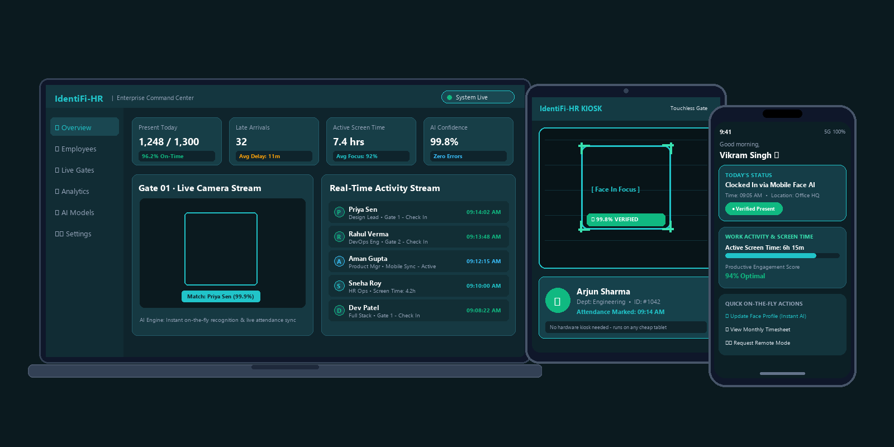
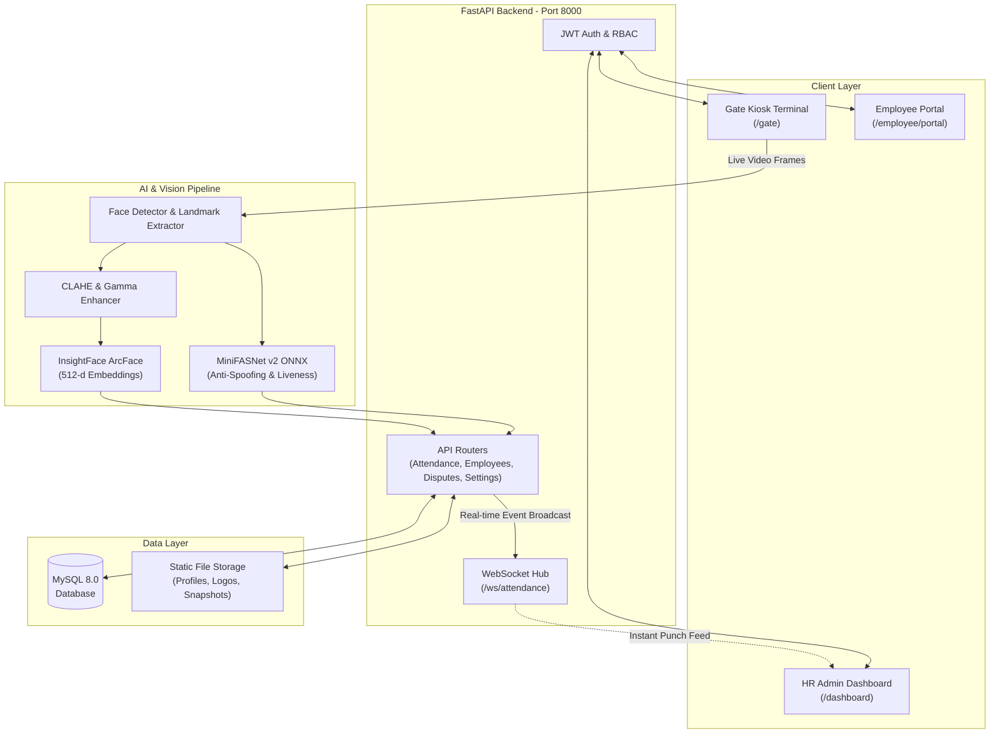

# 🚀 AI-Powered Face Attendance & Workforce Management System

An enterprise-grade, contactless facial recognition attendance and workforce management platform powered by **FastAPI**, **React 19**, **InsightFace (ArcFace)**, and **MiniFASNet Anti-Spoofing AI**.

<div align="center">
  
</div>

Designed for seamless kiosk deployment, high throughput entrance gates, real-time HR monitoring, employee self-service, and multi-tenant enterprise control.

---

## 🌟 Key Features

### 🎯 High-Precision Face Recognition Engine
- **InsightFace ArcFace (`buffalo_l`)**: 512-dimensional deep facial feature embeddings with cosine similarity matching.
- **Multi-Condition Illumination Normalization**: Dynamic **CLAHE** (Contrast Limited Adaptive Histogram Equalization in LAB color space) and non-linear **Gamma correction** for reliable recognition in dim or high-contrast lighting.
- **Multi-Angle & Pose Compensation**: 3D geometric pose estimation (yaw, pitch, roll) from 2D landmarks, tilt compensation, and bilateral angle symmetry for side-profile recognition (up to 45° yaw).

### 🛡️ Enterprise Anti-Spoofing & Liveness Detection
- **MiniFASNet v2 Neural Network**: ONNX-based deep anti-spoofing engine preventing proxy punches.
- **Multi-Attack Defense**: Detects printed photo cutouts, laminated ID cards, smartphone/tablet screen replays, and video loops.
- **Contextual Edge & Chrominance Analysis**: Analyzes high-frequency edges and color space distributions around facial boundaries to catch physical borders of held screens/photos.

### 🚪 Automated Gate & Kiosk Terminal (`/gate`)
- **Hands-Free Contactless Check-In**: High-speed, real-time video feed with tracking bounding boxes, confidence meters, and voice/audio feedback.
- **Smart Duplicate Prevention**: Configurable cooldown intervals to prevent accidental double-punching.
- **Offline / Reconnect Resilience**: Real-time WebSocket connection with automatic reconnect handlers.

### 💼 Complete HR Management Suite
- **Live Monitoring Dashboard**: Real-time punch feed streamed over WebSockets (`/ws/attendance`), daily attendance statistics, active vs late counts, and punch-clock feeds.
- **Employee Management**: Comprehensive directory with photo capture via webcam or file upload, department, designation, and multi-pose enrollment.
- **Attendance Disputes & Queries**: Integrated dispute review system (`/queries`) allowing HR admins to review, approve, or reject employee punch queries with notes.
- **Reports & Exporting**: Instant daily/monthly summaries with one-click **PDF** and **Excel (.xlsx)** export.
- **Alerts & Audit Center**: Suspicious activity alerts, spoof attempt logs, and snapshot audit trails for unverified attempts.
- **Unknown Identity Tracker**: Captures and logs photos of unrecognized individuals attempting check-in.
- **Customizable Shifts & Penalties**: Shift schedules, grace periods, half-day cutoffs, similarity thresholds, and company branding (custom logo & tenant name).

### 🙋 Employee Self-Service Portal (`/employee/portal`)
- **Personal Punch History**: Calendar-based view of check-in/out logs, work hours, and punctuality status.
- **Dispute Submission**: Direct submission of attendance disputes or missing punch rectification requests (`/attendance-query`).

### 🏢 Multi-Tenant & Super Admin Portal (`/super-admin`)
- Centralized organization management, tenant isolation, and administrative audit logging.

---

## 🏗️ System Architecture



---

## 💻 Tech Stack

| Layer | Technologies |
|---|---|
| **Frontend** | React 19, Vite, Tailwind CSS 4, React Router 7, Lucide Icons |
| **Backend API** | FastAPI, Python 3.10+, Uvicorn, WebSockets, Pydantic v2 |
| **Computer Vision & AI** | InsightFace (ArcFace), ONNX Runtime, OpenCV, MiniFASNet, NumPy |
| **Database & ORM** | MySQL 8.0, SQLAlchemy 2.0 (async), aiomysql, Alembic |
| **Reporting & Export** | jsPDF, jspdf-autotable, SheetJS (xlsx) |
| **DevOps & Containers** | Docker, Docker Compose |

---

## 📁 Repository Structure

```text
├── backend/
│   ├── alembic/                  # Database migration scripts
│   ├── app/
│   │   ├── api/                  # REST endpoints (auth, employees, face, attendance, etc.)
│   │   ├── core/                 # AI Engine, ArcFace, Liveness, WebSocket manager
│   │   ├── db/                   # SQLAlchemy async engine, session, and models
│   │   └── models/               # Pretrained ONNX models (minifasnet_v2.onnx)
│   ├── static/                   # Uploaded profile photos, company logos, snapshots
│   ├── scripts/                  # Seed scripts (seed_super_admin.py)
│   ├── requirements.txt          # Python dependencies
│   └── Dockerfile                # Backend container definition
│
├── hr-frontend/
│   ├── src/
│   │   ├── components/           # UI components (GateKiosk, Dashboard, Employees, etc.)
│   │   ├── App.jsx               # App routes & role-based guards
│   │   └── index.css             # Tailwind CSS styles
│   ├── package.json              # NPM dependencies & scripts
│   └── Dockerfile                # Frontend Nginx/Vite container definition
│
├── artifacts/                    # UI mockups and showcase assets
├── docker-compose.yml            # Multi-container orchestration (MySQL, API, Web)
├── .env.docker                   # Environment variables for Docker deployment
└── README.md                     # Project documentation
```

---

## ⚡ Quick Start (Local Setup)

### Prerequisites
- **Python 3.10+**
- **Node.js 18+** & `npm`
- **MySQL Server** (running locally or remotely)
- **C++ Build Tools / CMake** (required for `insightface` / `onnxruntime`)

---

### 1. Backend Setup

```bash
# Navigate to the backend directory
cd backend

# Create and activate virtual environment
# On Windows:
python -m venv .venv
.\.venv\Scripts\activate

# On Linux/macOS:
python3 -m venv .venv
source .venv/bin/activate

# Install dependencies
pip install --upgrade pip
pip install -r requirements.txt
```

#### Configure Environment Variables
Create a `.env` file inside `backend/`:
```env
DB_HOST=localhost
DB_USER=root
DB_PASSWORD=your_mysql_password
DB_NAME=attendance_db
DB_PORT=3306
SECRET_KEY=your_super_secret_jwt_key
```

#### Initialize Database & Run Migrations
```bash
# Apply Alembic database migrations
alembic upgrade head

# Seed default super admin account
python scripts/seed_super_admin.py
```

#### Start FastAPI Server
```bash
uvicorn app.main:app --reload --host 0.0.0.0 --port 8000
```
- API is running at: `http://localhost:8000`
- Interactive Swagger docs: `http://localhost:8000/docs`

---

### 2. Frontend Setup

Open a new terminal:

```bash
# Navigate to frontend directory
cd hr-frontend

# Install dependencies
npm install

# Start development server
npm run dev
```
- Frontend application is live at: `http://localhost:5173`

---

## 🐳 Docker Deployment (1-Command Run)

Spin up the entire stack (MySQL 8.0, FastAPI backend, and React web app) with Docker:

```bash
docker-compose --env-file .env.docker up --build
```

- **Frontend**: `http://localhost:5173`
- **Backend API**: `http://localhost:8000`
- **MySQL Database**: `localhost:3306`

---

## 🔑 Access Credentials & Navigation

| Portal | URL | Default Username | Default Password |
|---|---|---|---|
| **HR Admin Portal** | `http://localhost:5173/login` | `admin` | `password123` |
| **Super Admin Portal** | `http://localhost:5173/login` | `superadmin` | `superadmin123` |
| **Gate Kiosk Terminal** | `http://localhost:5173/gate` | *Direct Access* | *Hands-free Face Scan* |
| **Employee Self-Service** | `http://localhost:5173/login?tab=employee` | *Employee ID* | *Employee Password* |
| **Public Dispute Submission** | `http://localhost:5173/attendance-query` | *Direct Access* | *N/A* |
| **FastAPI Swagger Docs** | `http://localhost:8000/docs` | *Open Access* | *N/A* |

---

## 🔒 Security & Privacy Practices
- **Biometric Protection**: Stores 512-dimensional vector math embeddings rather than raw biometric matrices.
- **Anti-Replay & Liveness Checks**: Real-time deep learning verification blocks proxy attendance attempts.
- **JWT Session Security**: Role-based access tokens with strict expiration and protected endpoints.
- **Audit Logs**: Immutable audit log entries for every administrative action, user modification, and dispute resolution.

---

## 🤝 Contributing
Contributions are welcome! Please open an issue or submit a pull request for any enhancements or bug fixes.

---

## 📄 License
This project is open-source under the [MIT License](LICENSE).
